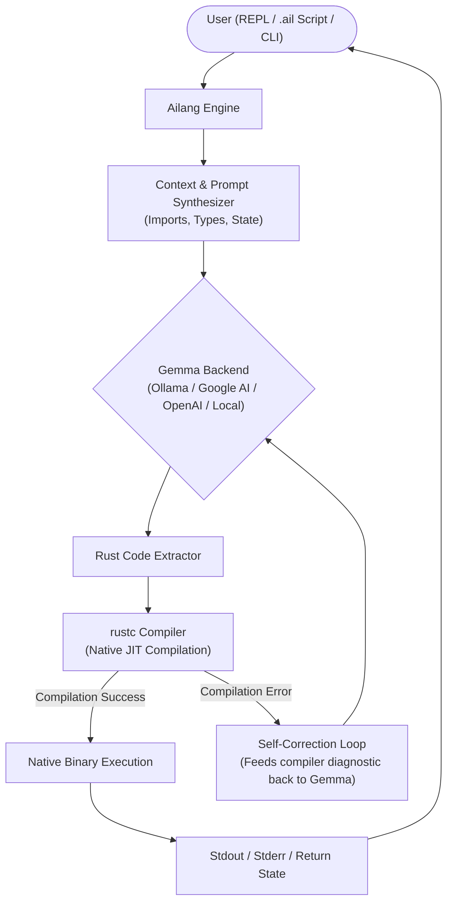

# Ailang: Natural Language ➜ Native Rust Dynamic Interpreter

[](https://github.com/rust-lang/rust)
[](https://github.com/QwenLM/Qwen2.5-Coder)
[](https://github.com/google-deepmind/gemma)
[](LICENSE)

**Ailang** is an interpreted programming language and JIT execution environment where high-level instructions (written in natural language, pseudocode, or domain-specific expressions) are translated by local LLMs (like **Qwen2.5-Coder:0.5b** and **Google Gemma**) directly into safe, memory-efficient, idiomatic **[Rust](https://github.com/rust-lang/rust)** and executed instantly.

---

## 🌟 Key Features

- **Dual-Mode Interpreter**: Features both a complete **native AST interpreter engine** (Lexer, Recursive-Descent Parser, Semantic Analyzer with Constant Folding, Environment & Scoping, Built-in Library) and an **LLM-Powered JIT compiler** (Google Gemma / Qwen2.5-Coder into native Rust).
- **On-the-Fly JIT Execution**: Seamlessly compiles generated Rust snippets using `rustc` (`--edition 2024`) with fast execution and outputs results in milliseconds.
- **Self-Healing / Error Correction**: If `rustc` reports a syntax error, type mismatch, or borrow-checker diagnostic, Ailang catches the error and sends it back to the model in a feedback loop to automatically repair the code.
- **Multiple Backends**:
  - **Local Ollama** (`qwen2.5-coder:0.5b`, `gemma2`, `gemma:2b`, etc.)
  - **Google AI Studio API** (Gemma & Gemini API via `GEMMA_API_KEY` or `GEMINI_API_KEY`)
  - **OpenAI-Compatible** (vLLM, `llama-server`, LM Studio, Groq)
  - **Local CLI Command** (`llama-cli`, `gemma.cpp`)
  - **Built-in Offline Synthesizer** (Works out of the box with zero external dependencies)
- **Interactive REPL**: A full-featured terminal REPL powered by `rustyline` with persistent history, state tracking, and introspection.
- **Transpiler Mode**: Export generated Rust code to standalone `.rs` files that can be built into standalone production binaries.

---

## 🏗️ Architecture



---

## 🚀 Quick Start

### Prerequisites

- **Rust toolchain** (`rustc` and `cargo`): [Install Rust](https://rustup.rs/)
- *(Optional)* **Ollama with Gemma 2**: `ollama run gemma2` or a **Google AI Studio API Key**.

### Installation

Clone the repository and build the release binary:

```bash
git clone https://github.com/shashank/Ailang.git # or your workspace
cd Ailang
cargo build --release
```

The compiled binary will be located at `./target/release/ailang`. You can link or copy it to `/usr/local/bin/ailang` or your PATH:

```bash
cp target/release/ailang /usr/local/bin/ailang
```

---

## 💻 Usage

### 1. Interactive REPL (`ailang repl` or simply `ailang`)

Launch the interactive REPL:

```bash
ailang
```

Example session:
```text
=========================================================
  Ailang: Google Gemma -> Native Rust Interpreter  
=========================================================
Backend: Ollama (Local Gemma)
Model:   gemma2
Tip: Type instructions or code. Enter :help for commands, :exit to quit.

ailang> calculate first 10 fibonacci numbers
Fibonacci sequence (first 10 numbers): 0 1 1 2 3 5 8 13 21 34 

ailang> create a struct Person with name and age and greet Alice
Hello! My name is Alice and I am 28 years old.

ailang> :rust
Show Rust code: ON

ailang> sort array [42, 13, 89, 7, 25, 64, 3, 99]
--- [Generated Rust Code] ---
fn main() {
    let mut numbers = vec![42, 13, 89, 7, 25, 64, 3, 99];
    numbers.sort();
    println!("Sorted: {:?}", numbers);
}
-----------------------------
Sorted: [3, 7, 13, 25, 42, 64, 89, 99]

ailang> :export sorted.rs
✓ Saved Rust code to sorted.rs

ailang> :exit
Goodbye!
```

#### REPL Commands:
- `:help` - Display available commands.
- `:state` - View active session definitions and execution history.
- `:vars` - View variables and functions in the native environment.
- `:tokens <code>` - Inspect Lexer tokens for code.
- `:ast <code>` - Inspect the Abstract Syntax Tree (AST) for code.
- `:rust` - Toggle printing the generated Rust code.
- `:verbose` - Toggle execution and compilation timing metrics.
- `:reset` - Reset session scope and definitions.
- `:export <file.rs>` - Save the last generated Rust code to a file.
- `:clear` - Clear the terminal screen.
- `:exit` / `:quit` - Exit the REPL.

---

### 2. Run Scripts (`ailang run <script.ail>`)

Write programs in `.ail` files:

```bash
# examples/primes.ail
calculate prime numbers up to 100
```

Execute with:

```bash
ailang run examples/primes.ail
```

Output:
```text
Prime numbers up to 50: [2, 3, 5, 7, 11, 13, 17, 19, 23, 29, 31, 37, 41, 43, 47]
```

---

### 3. Direct Instruction Evaluation (`ailang eval`)

Evaluate instructions on the fly directly from the shell:

```bash
ailang eval "draw a mandelbrot in ASCII"
```

Output:
```text
                                     . .#                   
                                     .*                     
                                   ..##**                   
                                   *####*                   
                            *.. ..#.*##*.*..   .            
                            .*#.############.**#            
                           ..##################.            
                          .*###################*            
               ... ..     *######################*          
                .#*###*...######################.           
               **########.######################.           
            .*.*#########*#####################*            
 #############################################.             
            .*.*#########*#####################*            
               **########.######################.           
                .#*###*...######################.           
               ... ..     *######################*          
                          .*###################*            
                           ..##################.            
                            .*#.############.**#            
                            *.. ..#.*##*.*..   .            
                                   *####*                   
                                   ..##**                   
                                     .*                     
```

---

### 4. Transpile to Rust Source (`ailang transpile`)

Transpile any instruction or `.ail` script into standalone Rust code:

```bash
ailang transpile "calculate prime numbers up to 50" -o primes.rs
```

Inspect the generated `primes.rs`:
```rust
fn is_prime(n: u64) -> bool {
    if n <= 1 { return false; }
    if n <= 3 { return true; }
    if n % 2 == 0 || n % 3 == 0 { return false; }
    let mut i = 5;
    while i * i <= n {
        if n % i == 0 || n % (i + 2) == 0 { return false; }
        i += 6;
    }
    true
}

fn main() {
    let limit = 50;
    let primes: Vec<u64> = (1..=limit).filter(|&x| is_prime(x)).collect();
    println!("Prime numbers up to {}: {:?}", limit, primes);
}
```

Compile directly with standard Rust:
```bash
rustc primes.rs -o primes && ./primes
```

---

### 5. Diagnostics & Environment Check (`ailang check`)

Verify your environment, compiler setup, and Gemma backend status:

```bash
ailang check
```

---

## ⚙️ Configuration & Backend Setup

Ailang supports multiple backends configured via CLI flags or environment variables:

| Backend | Flag / Environment Variable | Default Model | Notes |
| :--- | :--- | :--- | :--- |
| **Ollama** (Local) | `--backend ollama`<br>`OLLAMA_MODEL=qwen2.5-coder:0.5b`<br>`OLLAMA_HOST=http://localhost:11434` | `qwen2.5-coder:0.5b` | Ultra-fast local coding model (~390MB) or Gemma |
| **Google AI Studio** | `--backend google`<br>`GEMMA_API_KEY=your_key` or `GEMINI_API_KEY=...` | `gemma-2-27b-it` | High-quality cloud Gemma model |
| **OpenAI-Compatible** | `--backend openai`<br>`OPENAI_BASE_URL=...`<br>`OPENAI_API_KEY=...` | `gemma-2-9b-it` | Compatible with vLLM, llama.cpp, LocalAI, Groq |
| **Local Command** | `--backend cmd`<br>`GEMMA_CMD="gemma --prompt"` | `gemma` | Uses local CLI binaries |
| **Offline Synthesizer**| `--backend mock` | `mock` | Deterministic offline patterns (always ready) |

---

## 🧪 Testing

Ailang comes with a full test suite testing unit logic, compilation pipelines, error handling, and CLI integration:

```bash
cargo test
```

Result:
```text
running 10 tests (unit tests in lib & main)
test result: ok. 10 passed; 0 failed

running 9 tests (native interpreter: lexer, parser, ast, semantic, evaluator)
test result: ok. 9 passed; 0 failed

running 5 tests (http server integration tests)
test result: ok. 5 passed; 0 failed

running 10 tests (cli integration tests)
test result: ok. 10 passed; 0 failed
```

---

## 🤝 Upstream Projects

- **Google Gemma**: [https://github.com/google-deepmind/gemma](https://github.com/google-deepmind/gemma)
- **Rust Programming Language**: [https://github.com/rust-lang/rust](https://github.com/rust-lang/rust)

---

## 📄 License

This project is licensed under the MIT License - see the [LICENSE](LICENSE) file for details.

